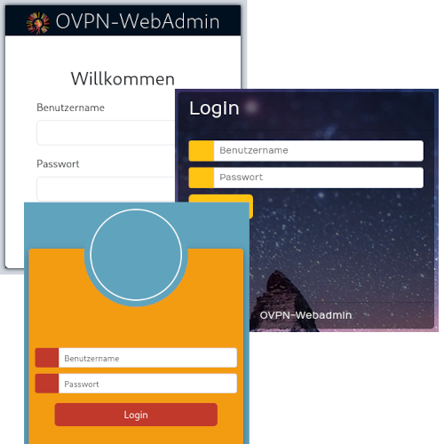
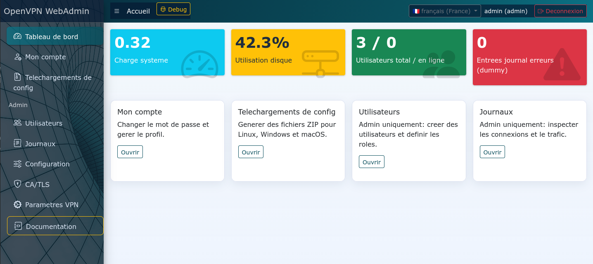
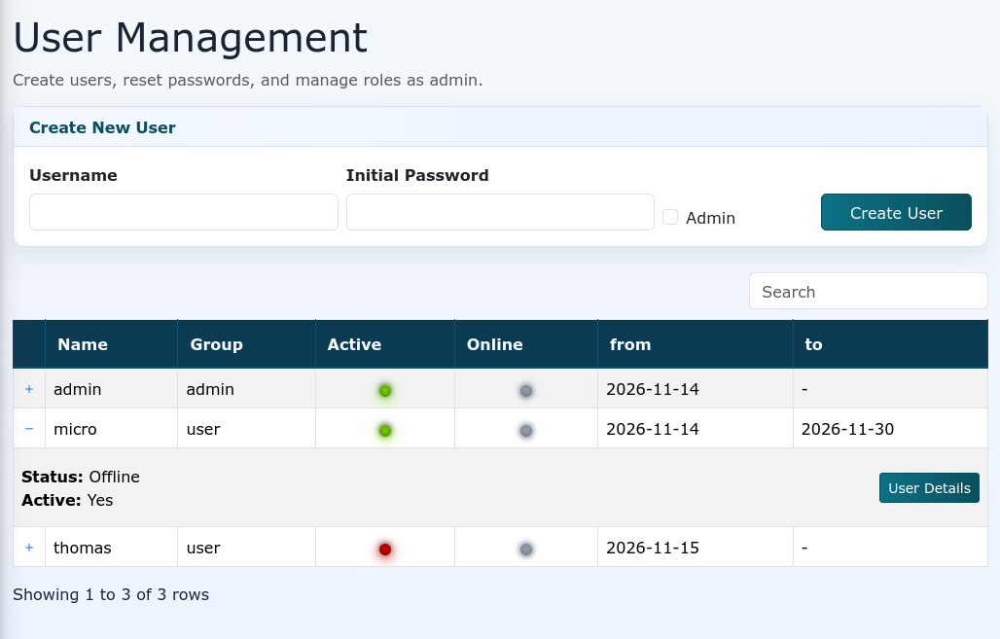

# OpenVPN-WebAdmin

## Release 2.0.1

[🇩🇪 German documentation](README_DE.md)

[🇬🇧 English documentation](README.md)

[🇫🇷 French documentation](README_FR.md)

**All good things take time!**

I hope you like it as much as I do. I have spent over two years working on this release. Arriving a year later than announced, here is the new, completely rewritten version of **OpenVPN-WebAdmin**.

### A web-based administration interface for OpenVPN servers

OpenVPN-WebAdmin is an open-source PHP application for managing and administering an OpenVPN server through a web browser. The project provides a clear and user-friendly administration interface for handling recurring administrative tasks without having to perform every step directly from the command line.

The application is aimed particularly at self-hosted infrastructures, private networks and smaller environments where administrators want to retain full control over their OpenVPN installation.

---

## Setup documentation

[🇩🇪 German documentation](doc/setup/README_DE.md)

[🇬🇧 English documentation](doc/setup/README.md)

[🇫🇷 French documentation](doc/setup/README_FR.md)

## Screenshots

## Project goals

OpenVPN-WebAdmin is based on a few fundamental principles:

- **Self-hosted:** The application runs on your own infrastructure.
- **Multilingual:** The system has been designed for multilingual operation from the outset. Add a new language – that's it.
- **Help pages:** Dedicated help pages can be created for each context entry and each page. These can also be multilingual. Create a new one – that's it.
- **Privacy:** No external services or CDNs are required to serve the frontend.
- **Independence:** Neither a Docker environment nor cloud-based infrastructure is required.
- **For developers:** There is a dedicated, searchable system for documenting and searching the PHP scripts by their functions and classes.

### System requirements

Developed and tested on **Debian 13**. A bare-bones operating system is sufficient. The installation script automatically installs all required libraries, depending on the selected setup configuration.

## Features

### Web-based administration

OpenVPN-WebAdmin provides a browser-based interface for administrative tasks.

These include:

- User management
- User groups and permission levels
- Management of OpenVPN-related user settings
- Management of client configuration files
- Display of connection and disconnection events
- Multilingual user interface
- Configurable login designs

The user interface is based on AdminLTE 3.2.0 and Bootstrap.

The admin dashboard shows the connection count and received, sent and total traffic for the current database month in GB (1 GB = 1024³ bytes). Connections are assigned by their start time; traffic is updated by the disconnect script when a connection ends, so ongoing connections do not have up-to-date traffic values.

### User and client management

Users are managed centrally through the database. Each user is assigned their own OpenVPN client identity. The username is used as the Common Name (CN) of the corresponding client certificate.

A fixed VPN IP address can be assigned to each user. The assignment is handled by the OpenVPN connection scripts. When a connection is established, the assigned address is retrieved from the database and made available to OpenVPN.

This provides transparent and centrally managed IP address allocation, rather than relying solely on dynamically assigned client addresses.

### OpenVPN integration

OpenVPN-WebAdmin has its own connection and disconnection scripts for logging user activity. These scripts communicate with the application database and process the corresponding connection events.

The web application and the OpenVPN server remain separate components. The web application does not require unrestricted root privileges for regular user administration.

**Exception:** New users are created. For this, a script must be executed on the server. It is used to create and manage certificates and their private keys. This deliberately remains outside the web application, preventing sensitive cryptographic key material from being directly controlled by the web interface.

## Technical architecture

OpenVPN-WebAdmin uses a traditional server-side PHP architecture.

| Component | Technology |
|---|---|
| Backend | PHP |
| Database | MariaDB / MySQL |
| Web server | Apache 2 or Nginx |
| VPN service | OpenVPN |
| Frontend framework | AdminLTE 3.2.0 |
| CSS framework | Bootstrap |
| JavaScript | jQuery and other libraries |
| Installation | Bash |
| Database connectivity | PHP database interface |

The database can be hosted locally or on a separate database server.

Apache and Nginx are supported as web servers. The installation can use an existing web server or prepare a new installation.

## Frontend and local libraries

All frontend libraries are provided locally within the application. OpenVPN-WebAdmin does not rely on external CDNs when loading its CSS files, JavaScript libraries, fonts or icons.

This offers several advantages:

- No CDN-related connections to external third parties.
- No additional transfer of browser data to CDN providers.
- No dependency on the availability of external CDN services.
- Full control over the versions of the libraries used.
- Predictable behaviour of the user interface.

The frontend files are prepared independently of the application itself. The build process uses Node.js and npm. The finished files are then bundled into a TAR.GZ archive and provided with a SHA256 checksum. During installation, the prepared archive is verified and deployed automatically. If a prepared asset archive is included, Node.js and npm are not required on the production server.

Further information can be found in the project documentation under *Local deployment of frontend libraries*.

## Installation

OpenVPN-WebAdmin comes with an interactive installation script. The setup guides the administrator through the required configuration settings. It is currently available in English, German and French.

The installation includes:

1. Checking the system and existing environment.
2. Selecting the source repository and branch to use.
3. Defining the installation and target directories.
4. Configuring the web server user and associated group.
5. Setting up the database connection.
6. Optionally creating a local MariaDB database.
7. Creating the first administrator account.
8. Deploying the application files.
9. Installing the frontend libraries.
10. Creating the application configuration.
11. Integrating with the OpenVPN server.
12. Optional automatic configuration of Apache or Nginx.
13. Setting and checking file permissions.

The installer supports two deployment options:

- **Standalone:** OpenVPN-WebAdmin is deployed as a separate website.
- **Subdirectory:** The application is made available under a path such as `/openvpnwebadmin`.

An existing database server and web server can also be used.

### Installation requirements

The following are required for installation:

- Debian 13 with APT package management.
- Root privileges during installation.
- PHP with the required PHP extensions.
- MariaDB or MySQL.
- Apache 2 or Nginx.
- Git and the required system tools.

The actual packages required depend on the installation options selected.

## Security aspects

Security is an essential part of the project architecture. The fundamental principles include:

**Separation of responsibilities**

The PHP application, database and OpenVPN service have clearly separated responsibilities. The web application does not require unrestricted system privileges for regular administration.

**External certificate management**

Private keys and certificates are not created or managed by the web application. Their creation and deployment remain separate administrative tasks.

**Controlled file permissions**

Application files, configuration files and OpenVPN integration scripts are installed with defined ownership and permissions.

**Local frontend dependencies**

The application does not rely on external CDN providers or their delivery services.

**Controlled installation**

The installer explicitly collects and checks the required configuration parameters before the actual installation begins. Security also depends on the correct configuration of the underlying Linux system, database, web server and OpenVPN service.

## Project structure

The repository separates the application, server-side integration, installation resources and frontend files.

Important directories:

| Directory | Purpose |
|---|---|
| `public/` | Public web entry point and frontend resources |
| `src/` | Application source code |
| `html/` | HTML templates and login designs |
| `config/` | Application configuration templates |
| `storage/` | Application configurations, data and runtime files |
| `server/installation/` | Database installation resources |
| `server/scripte/` | OpenVPN connection and disconnection scripts |
| `assets-build/` | Environment for building and deploying frontend libraries |
| `doc/` | Project documentation |

The installation script and its associated shell functions are provided separately.

When `sudo ./update.sh` is executed, the OpenVPN shell scripts in the selected script directory (default `/etc/openvpn/scripts`) are updated alongside the web administration files, using owner `root:root` and mode `0750`.

The existing `config.sh`, locally present files, `config/config.php` and `.env`, as well as existing `.ovpn` templates, remain unchanged.

### Storage and server configuration

The setup creates `storage/conf/{linux,osx,windows}/history`, `storage/conf/history/server` and `storage/logs` within the selected deployment directory. Missing `client.ovpn` and `update-resolv.sh` templates are copied; existing storage files are preserved.

Writable directories belong to `www-data:www-data` and have mode `2770` (Setgid). Default ACLs also grant access to a different web server user, if applicable.

Existing files are made readable and writable for these users; other users have no access. Inherited ACLs only apply within the permissions requested by the creator: files explicitly created with `0600` remain inaccessible to other users.

The setup checks actual access permissions and aborts if errors occur.

When setting up or renewing the VPN server, `server/installation/openvpn-setup-easyrsa.sh` asks for the deployment directory. It creates `storage/conf/server/server.conf` there as a symbolic link to `/etc/openvpn/server.conf`. Any existing file or other link is backed up beforehand using a unique `.bak.*` name.

The link directory belongs to `root:www-data` (mode `0750`), and the server file belongs to `root:www-data` (mode `0640`): `www-data` and the deployment owner are granted read-only access at most via ACLs; the deployment must not be owned by `root`.

The web administration view of linked server configurations is therefore read-only. Local, non-linked configurations retain their previous storage behaviour.

## Development

OpenVPN-WebAdmin is developed with the aim of providing source code that is easy to understand and maintain. The project uses established technologies and avoids the need for an extensive additional runtime environment.

The frontend libraries are managed using npm on the development machine. Their versions are defined in `package.json` and `package-lock.json`.

The prepared frontend files are then incorporated into the application deployment. The development environment with Node.js and npm is not required on the production server.

## Licence

OpenVPN-WebAdmin is released under the terms of the **GNU Affero General Public License Version 3.0 (AGPL-3.0)**.

The full licence text can be found in the file [LICENSE.md](LICENSE.md).

## Project

**GitHub repository:** [Wutze/OpenVPN-WebAdmin](https://github.com/Wutze/OpenVPN-WebAdmin)

Bug reports, suggestions for improvement and contributions to further development are welcome via the project's issue tracker.

---

*OpenVPN-WebAdmin – Managing your own OpenVPN infrastructure. Under your own control.*
