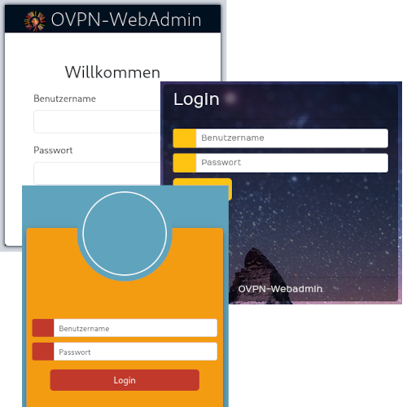
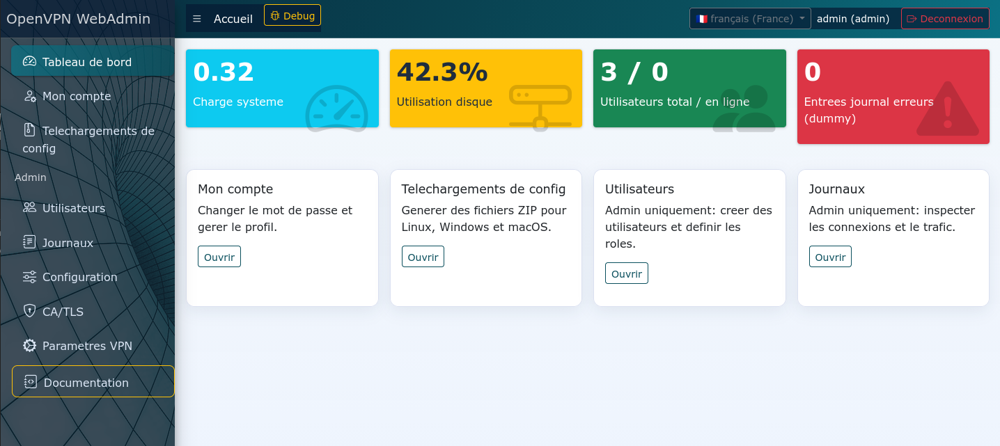
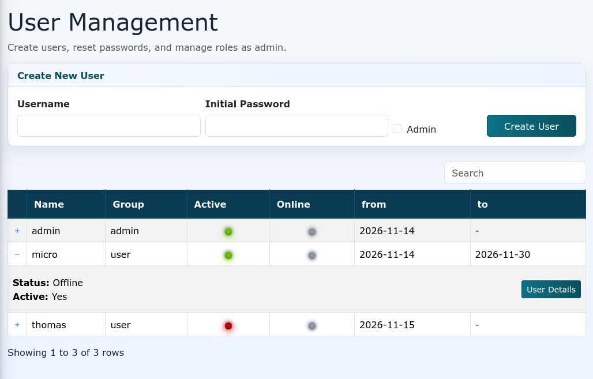

# OpenVPN-WebAdmin
## Release BETA 2.0.0

**Eine webbasierte Administrationsoberfläche für OpenVPN-Server.**

OpenVPN-WebAdmin ist eine Open-Source-PHP-Anwendung zur Verwaltung und Administration eines OpenVPN-Servers über einen Webbrowser. Das Projekt bietet eine übersichtliche und benutzerfreundliche Administrationsoberfläche, mit der sich wiederkehrende Verwaltungsaufgaben erledigen lassen, ohne dafür jeden Arbeitsschritt direkt auf der Kommandozeile ausführen zu müssen.

Die Anwendung richtet sich insbesondere an selbst betriebene Infrastrukturen, private Netzwerke und kleinere Umgebungen, in denen Administratoren die vollständige Kontrolle über ihre OpenVPN-Installation behalten möchten.

---

## Extended documentation

[![Doku English]🇬🇧](doc/README.md)
[![Doku Deutsch/German]🇩🇪](doc/README_DE.md)

## Screenshots





## Projektziele

OpenVPN-WebAdmin basiert auf einigen grundlegenden Prinzipien:

- **Selbst gehostet:** Die Anwendung wird auf der eigenen Infrastruktur betrieben.
- **Mehrsprachigkeit:** Das System ist von Anfang an auf Mehrsprachigen Betrieb ausgelegt. Neue Sprache einkopieren - fertig
- **Hilfestellungen:** Zu jedem Kontexteintrag, zu jeder Seite kann eine eigene Hilfeseite aufgebaut werden. Auch diese können Mehrsprachig sein. Neu anlegen, fertig
- **Datenschutz:** Für die Frontend-Bereitstellung werden keine externen Dienste oder CDNs benötigt.
- **Unabhängigkeit:** Es wird weder eine Docker-Umgebung noch eine cloudbasierte Infrastruktur vorausgesetzt.
- **Für Entwickler:** Es gibt ein eigenes, durchsuchbares System um die enthaltenen PHP Scripte nach ihren Funktionen und Klassen zu dokumentieren und zu suchen.

## Installation

Start with Code:

```code
bash <(wget -qO- 'https://raw.githubusercontent.com/Wutze/OpenVPN-WebAdmin/master/install.sh')
```

```bash
bash <(wget -qO- 'http://gitlab1.home/micro/openvpn-webadmin-intern/-/raw/main/setup.sh?ref_type=heads&inline=false')
```

## Funktionen

### Webbasierte Administration

OpenVPN-WebAdmin stellt eine browserbasierte Oberfläche für administrative Aufgaben bereit.

Dazu gehören:

- Benutzerverwaltung
- Benutzergruppen und Berechtigungsstufen
- Verwaltung der OpenVPN-bezogenen Benutzereinstellungen
- Verwaltung der Client-Konfigurationsdateien
- Anzeige von Verbindungs- und Trennungsereignissen
- Mehrsprachige Benutzeroberfläche
- Konfigurierbare Login-Designs

Die Benutzeroberfläche basiert auf AdminLTE 3.2.0 und Bootstrap.

### Benutzer- und Clientverwaltung

Die Benutzer werden zentral über die Datenbank verwaltet. Jedem Benutzer wird eine eigene OpenVPN-Client-Identität zugeordnet. Der Benutzername wird dabei als Common Name (CN) des entsprechenden Client-Zertifikats verwendet.

Jedem Benutzer kann eine feste VPN-IP-Adresse zugewiesen werden. Die Zuordnung erfolgt über die OpenVPN-Verbindungsskripte. Beim Verbindungsaufbau wird die zugewiesene Adresse aus der Datenbank abgerufen und OpenVPN zur Verfügung gestellt.

Dadurch entsteht eine nachvollziehbare und zentral verwaltete IP-Adressvergabe, anstatt ausschließlich auf dynamisch zugewiesene Client-Adressen zurückzugreifen.

### Integration in OpenVPN

OpenVPN-WebAdmin besitzt eigene Verbindungs- und Trennungsskripte zum logging der Benutzeraktivitäten. Diese Skripte kommunizieren mit der Anwendungsdatenbank und verarbeiten die zugehörigen Verbindungsereignisse. Die Webanwendung und der OpenVPN-Server bleiben eigenständige Komponenten. Für die reguläre Benutzerverwaltung benötigt die Webanwendung keine uneingeschränkten Root-Rechte. *Ausnahme:* Es werden neue Benutzer angelegt, hierfür muss ein Script auf dem Server ausgeführt werden. Diese dienen der Erstellung und Verwaltung von Zertifikaten und deren privaten Schlüsseln. Das bleibt bewusst außerhalb der Webanwendung. Dadurch wird vermieden, dass sensibles kryptografisches Schlüsselmaterial unmittelbar der Weboberfläche unterliegt.

## Technische Architektur

OpenVPN-WebAdmin verwendet eine klassische serverseitige PHP-Architektur.

| Komponente | Technologie |
|---|---|
| Backend | PHP |
| Datenbank | MariaDB / MySQL |
| Webserver | Apache 2 oder Nginx |
| VPN-Dienst | OpenVPN |
| Frontend-Framework | AdminLTE 3.2.0 |
| CSS-Framework | Bootstrap |
| JavaScript | jQuery und weitere Bibliotheken |
| Installation | Bash |
| Datenbankanbindung | PHP-Datenbankschnittstelle |

Die Datenbank kann lokal oder auf einem separaten Datenbankserver betrieben werden.

Apache und Nginx werden als Webserver unterstützt. Die Installation kann sowohl einen vorhandenen Webserver verwenden als auch eine neue Installation vorbereiten.

## Frontend und lokale Bibliotheken

Sämtliche Frontend-Bibliotheken werden lokal innerhalb der Anwendung bereitgestellt. OpenVPN-WebAdmin ist beim Laden seiner CSS-Dateien, JavaScript-Bibliotheken, Schriftarten und Icons nicht auf externe CDNs angewiesen.

Das bietet mehrere Vorteile:

- Keine CDN-bedingten Verbindungen zu externen Drittanbietern.
- Keine zusätzliche Übertragung von Browserdaten an CDN-Anbieter.
- Keine Abhängigkeit von der Verfügbarkeit externer CDN-Dienste.
- Vollständige Kontrolle über die verwendeten Bibliotheksversionen.
- Vorhersehbares Verhalten der Benutzeroberfläche.

Die Frontend-Dateien werden unabhängig von der eigentlichen Anwendung vorbereitet. Der Build-Prozess verwendet Node.js und npm ausschließlich auf dem Entwicklungsrechner. Die fertigen Dateien werden anschließend in einem TAR.GZ-Archiv zusammengefasst und mit einer SHA256-Prüfsumme versehen.

Während der Installation wird das vorbereitete Archiv überprüft und automatisch bereitgestellt. Wenn ein vorbereitetes Asset-Archiv mitgeliefert wird, sind Node.js und npm auf dem Produktivserver nicht erforderlich. 

Weitere Informationen dazu befinden sich in der Projektdokumentation unter *Lokale Bereitstellung der Frontend-Bibliotheken*.

## Installation

OpenVPN-WebAdmin verfügt über ein interaktives Installationsskript. Das Setup führt den Administrator durch die erforderlichen Konfigurationseinstellungen.

Die Installation umfasst:

1. Prüfung des Systems und der vorhandenen Umgebung.
2. Auswahl des Quell-Repositories und des zu verwendenden Branches.
3. Festlegung der Installations- und Zielverzeichnisse.
4. Konfiguration des Webserver-Benutzers und der zugehörigen Gruppe.
5. Einstellungen für die Datenbankverbindung.
6. Optionales Erstellen einer lokalen MariaDB-Datenbank.
7. Anlegen des ersten Administratorkontos.
8. Bereitstellung der Anwendungsdateien.
9. Installation der Frontend-Bibliotheken.
10. Erstellung der Anwendungskonfiguration.
11. Integration in den OpenVPN-Server.
12. Optionale automatische Konfiguration von Apache oder Nginx.
13. Vergabe und Überprüfung der Dateiberechtigungen.

Das Installationsprogramm unterstützt zwei Bereitstellungsvarianten:

- **Standalone:** OpenVPN-WebAdmin wird als eigenständige Website bereitgestellt.
- **Unterverzeichnis:** Die Anwendung wird unter einem Pfad wie `/openvpnwebadmin` erreichbar gemacht.

Auch ein bereits vorhandener Datenbankserver und Webserver können verwendet werden.

### Installationsvoraussetzungen

Für die Installation werden benötigt:

- Ein unterstütztes Debian-basiertes Linux-System mit APT-Paketverwaltung.
- Root-Rechte während der Installation.
- PHP mit den benötigten PHP-Erweiterungen.
- MariaDB oder MySQL.
- Apache 2 oder Nginx.
- Ein installierter oder separat vorbereiteter OpenVPN-Server.
- Git und die benötigten Systemwerkzeuge.

Welche Pakete tatsächlich benötigt werden, richtet sich nach den gewählten Installationsoptionen.

## Sicherheitsaspekte

Sicherheit ist ein wesentlicher Bestandteil der Projektarchitektur. Zu den grundlegenden Prinzipien gehören:

**Trennung der Zuständigkeiten**

PHP-Anwendung, Datenbank und OpenVPN-Dienst haben klar voneinander getrennte Aufgaben. Die Webanwendung benötigt für die reguläre Administration keine uneingeschränkten Systemrechte.

**Externe Zertifikatsverwaltung**

Private Schlüssel und Zertifikate werden nicht durch die Webanwendung erstellt oder verwaltet. Ihre Erstellung und Bereitstellung bleiben separate administrative Aufgaben.

**Kontrollierte Dateiberechtigungen**

Anwendungsdateien, Konfigurationsdateien und OpenVPN-Integrationsskripte werden mit definierten Eigentümern und Berechtigungen installiert.

**Lokale Frontend-Abhängigkeiten**

Die Anwendung ist nicht auf externe CDN-Anbieter oder deren Bereitstellungsdienste angewiesen.

**Kontrollierte Installation**

Das Installationsprogramm erfasst und überprüft die erforderlichen Konfigurationsparameter ausdrücklich, bevor die eigentliche Installation beginnt. Die Sicherheit hängt darüber hinaus von der korrekten Konfiguration des zugrunde liegenden Linux-Systems, der Datenbank, des Webservers und des OpenVPN-Dienstes ab.

## Projektstruktur

Das Repository trennt die Anwendung, die serverseitige Integration, die Installationsressourcen und die Frontend-Dateien voneinander.

Wichtige Verzeichnisse:

| Verzeichnis | Zweck |
|---|---|
| `public/` | Öffentlicher Web-Einstiegspunkt und Frontend-Ressourcen |
| `src/` | Quellcode der Anwendung |
| `html/` | HTML-Vorlagen und Login-Designs |
| `config/` | Vorlagen für die Anwendungskonfiguration |
| `storage/` | Anwendungskonfigurationen, Daten und Laufzeitdateien |
| `server/installation/` | Ressourcen für die Datenbankinstallation |
| `server/scripte/` | OpenVPN-Verbindungs- und Trennungsskripte |
| `assets-build/` | Umgebung zum Erstellen und Bereitstellen der Frontend-Bibliotheken |
| `doc/` | Projektdokumentation |

Das Installationsskript und die zugehörigen Shell-Funktionen werden separat bereitgestellt.

## Entwicklung

OpenVPN-WebAdmin wird mit dem Ziel entwickelt, einen nachvollziehbaren und wartbaren Quellcode bereitzustellen. Das Projekt setzt auf etablierte Technologien und vermeidet die Notwendigkeit einer umfangreichen zusätzlichen Laufzeitumgebung. Die Frontend-Bibliotheken werden auf dem Entwicklungsrechner über npm verwaltet. Ihre Versionen werden in `package.json` und `package-lock.json` festgelegt.

Die vorbereiteten Frontend-Dateien werden anschließend in die Anwendungsbereitstellung übernommen. Die Entwicklungsumgebung mit Node.js und npm ist auf dem Produktivserver nicht erforderlich.

## Lizenz

OpenVPN-WebAdmin wird unter den Bedingungen der **GNU Affero General Public License Version 3.0 (AGPL-3.0)** veröffentlicht.

Der vollständige Lizenztext befindet sich in der Datei [LICENSE.md](LICENSE.md).

## Projekt

**GitHub-Repository:** [Wutze/OpenVPN-WebAdmin](https://github.com/Wutze/OpenVPN-WebAdmin)

Fehlerberichte, Verbesserungsvorschläge und Beiträge zur Weiterentwicklung sind über den Issue-Tracker des Projekts willkommen.

---

*OpenVPN-WebAdmin – Die Verwaltung deiner eigenen OpenVPN-Infrastruktur. Unter deiner eigenen Kontrolle.*
