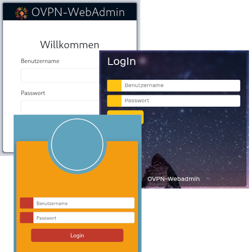
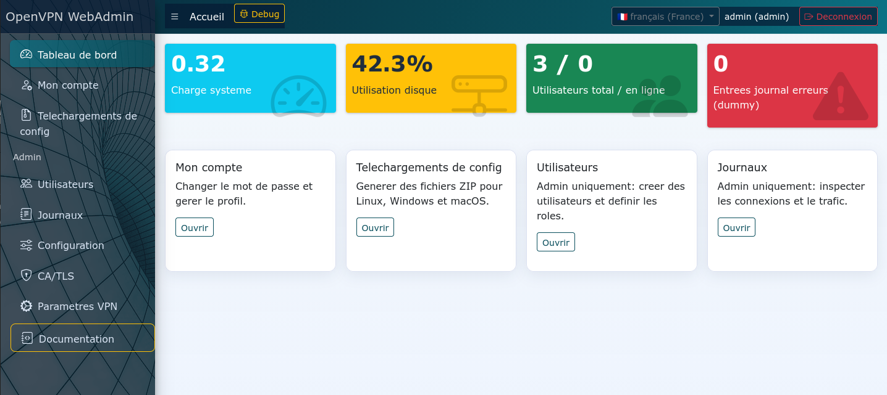
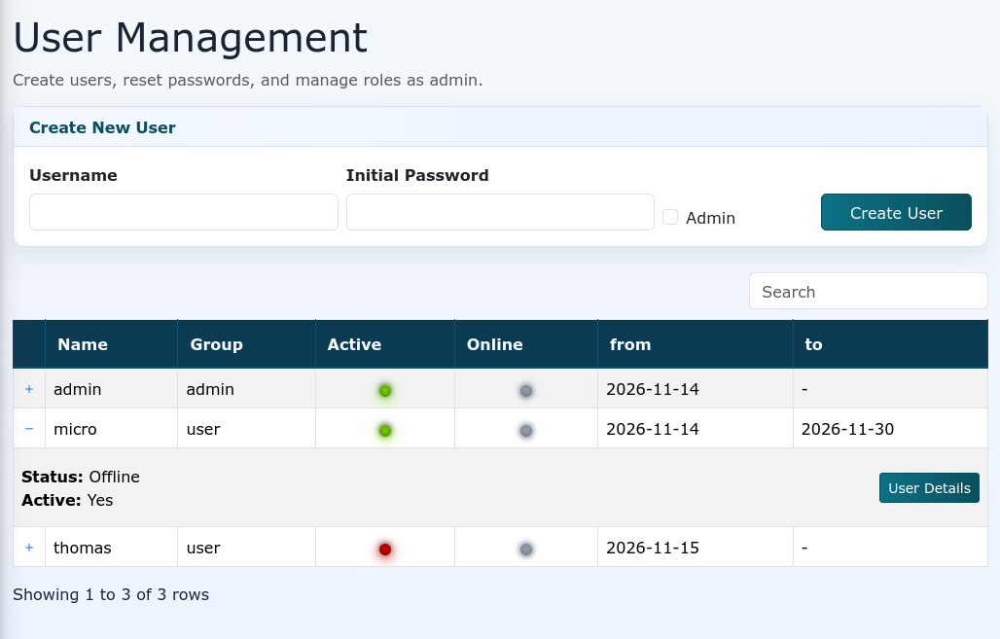

# OpenVPN-WebAdmin

## Release 2.0.x

**Tout vient à point à qui sait attendre !**

J'espère que cette nouvelle version vous plaira autant qu'à moi. J'ai consacré plus de deux ans à son développement. Avec un an de retard sur la date annoncée, voici enfin la nouvelle version entièrement réécrite d'**OpenVPN-WebAdmin**.

### Une interface d'administration web pour les serveurs OpenVPN

OpenVPN-WebAdmin est une application PHP open source permettant de gérer et d'administrer un serveur OpenVPN via un navigateur web. Le projet propose une interface d'administration claire et conviviale qui permet d'effectuer les tâches administratives récurrentes sans devoir réaliser chaque étape directement en ligne de commande.

L'application s'adresse notamment aux infrastructures auto-hébergées, aux réseaux privés et aux environnements de petite taille dans lesquels les administrateurs souhaitent conserver le contrôle total de leur installation OpenVPN.

---

## Documentation du setup

[🇩🇪 Documentation allemande](doc/setup/README_DE.md)

[🇬🇧 Documentation anglaise](doc/setup/README.md)

[🇫🇷 Documentation française](doc/setup/README_FR.md)

## Captures d'écran

## Objectifs du projet

OpenVPN-WebAdmin repose sur quelques principes fondamentaux :

- **Auto-hébergé :** L'application fonctionne sur sa propre infrastructure.
- **Multilingue :** Le système est conçu dès le départ pour fonctionner en plusieurs langues. Ajouter une nouvelle langue – et voilà.
- **Aide :** Une page d'aide dédiée peut être créée pour chaque élément contextuel et chaque page. Ces pages peuvent également être multilingues. En créer une nouvelle – et voilà.
- **Protection des données :** Aucun service externe ni CDN n'est nécessaire pour fournir le frontend.
- **Indépendance :** Aucun environnement Docker ni infrastructure cloud n'est requis.
- **Pour les développeurs :** Un système dédié et consultable permet de documenter et de rechercher les scripts PHP selon leurs fonctions et leurs classes.

### Configuration requise

Développé et testé sous **Debian 13**. Un système d'exploitation minimal suffit. Le script d'installation installe automatiquement toutes les bibliothèques nécessaires, en fonction de la configuration choisie.

## Fonctionnalités

### Administration web

OpenVPN-WebAdmin propose une interface web permettant d'effectuer les tâches administratives.

Cela comprend :

- Gestion des utilisateurs
- Groupes d'utilisateurs et niveaux d'autorisation
- Gestion des paramètres utilisateurs liés à OpenVPN
- Gestion des fichiers de configuration client
- Affichage des événements de connexion et de déconnexion
- Interface multilingue
- Thèmes de connexion configurables

L'interface utilisateur repose sur AdminLTE 3.2.0 et Bootstrap.

Le tableau de bord administrateur affiche le nombre de connexions et le trafic reçu, envoyé et total du mois courant de la base de données en Go (1 Go = 1024³ octets). Les connexions sont attribuées selon leur heure de début ; le script de déconnexion actualise le trafic à la fin de la connexion, les valeurs des connexions en cours ne sont donc pas à jour.

### Gestion des utilisateurs et des clients

Les utilisateurs sont gérés de manière centralisée dans la base de données. Chaque utilisateur dispose de sa propre identité OpenVPN client. Le nom d'utilisateur est utilisé comme Common Name (CN) du certificat client correspondant.

Une adresse IP VPN fixe peut être attribuée à chaque utilisateur. L'attribution est gérée par les scripts de connexion OpenVPN. Lors de l'établissement de la connexion, l'adresse attribuée est récupérée dans la base de données et mise à disposition d'OpenVPN.

Cela permet une attribution des adresses IP centralisée et transparente, plutôt que de dépendre uniquement d'adresses attribuées dynamiquement aux clients.

### Intégration à OpenVPN

OpenVPN-WebAdmin dispose de ses propres scripts de connexion et de déconnexion pour enregistrer les activités des utilisateurs. Ces scripts communiquent avec la base de données de l'application et traitent les événements de connexion correspondants.

L'application web et le serveur OpenVPN restent des composants indépendants. Pour la gestion courante des utilisateurs, l'application web n'a pas besoin de droits root illimités.

**Exception :** La création de nouveaux utilisateurs nécessite l'exécution d'un script sur le serveur. Celui-ci sert à créer et à gérer les certificats ainsi que leurs clés privées. Cette opération reste volontairement en dehors de l'application web. Cela permet d'éviter que des données cryptographiques sensibles soient directement accessibles à l'interface web.

## Architecture technique

OpenVPN-WebAdmin utilise une architecture PHP classique côté serveur.

| Composant | Technologie |
|---|---|
| Backend | PHP |
| Base de données | MariaDB / MySQL |
| Serveur web | Apache 2 ou Nginx |
| Service VPN | OpenVPN |
| Framework frontend | AdminLTE 3.2.0 |
| Framework CSS | Bootstrap |
| JavaScript | jQuery et autres bibliothèques |
| Installation | Bash |
| Accès à la base de données | Interface PHP de base de données |

La base de données peut être hébergée localement ou sur un serveur distinct.

Apache et Nginx sont pris en charge comme serveurs web. L'installation peut utiliser un serveur web existant ou préparer une nouvelle installation.

## Frontend et bibliothèques locales

Toutes les bibliothèques frontend sont fournies localement au sein de l'application. OpenVPN-WebAdmin ne dépend d'aucun CDN externe pour le chargement de ses fichiers CSS, bibliothèques JavaScript, polices ou icônes.

Cela offre plusieurs avantages :

- Aucune connexion à des tiers liée aux CDN.
- Aucun transfert supplémentaire de données du navigateur vers les fournisseurs de CDN.
- Aucune dépendance à la disponibilité de services CDN externes.
- Contrôle total des versions des bibliothèques utilisées.
- Comportement prévisible de l'interface utilisateur.

Les fichiers frontend sont préparés indépendamment de l'application elle-même. Le processus de build utilise Node.js et npm. Les fichiers finalisés sont ensuite regroupés dans une archive TAR.GZ accompagnée d'une somme de contrôle SHA256. Lors de l'installation, l'archive préparée est vérifiée puis déployée automatiquement. Si une archive des ressources préparées est fournie, Node.js et npm ne sont pas nécessaires sur le serveur de production.

Vous trouverez davantage d'informations à ce sujet dans la documentation du projet, sous *Déploiement local des bibliothèques frontend*.

## Installation

OpenVPN-WebAdmin dispose d'un script d'installation interactif. Le setup guide l'administrateur à travers les paramètres de configuration nécessaires. Il est actuellement disponible en anglais, allemand et français.

L'installation comprend :

1. Vérification du système et de l'environnement existant.
2. Sélection du dépôt source et de la branche à utiliser.
3. Définition des répertoires d'installation et de destination.
4. Configuration de l'utilisateur du serveur web et de son groupe.
5. Paramètres de connexion à la base de données.
6. Création facultative d'une base de données MariaDB locale.
7. Création du premier compte administrateur.
8. Déploiement des fichiers de l'application.
9. Installation des bibliothèques frontend.
10. Création de la configuration de l'application.
11. Intégration au serveur OpenVPN.
12. Configuration automatique facultative d'Apache ou de Nginx.
13. Attribution et vérification des permissions sur les fichiers.

Le programme d'installation prend en charge deux modes de déploiement :

- **Standalone :** OpenVPN-WebAdmin est déployé comme un site web indépendant.
- **Sous-répertoire :** L'application est accessible via un chemin tel que `/openvpnwebadmin`.

Un serveur de base de données et un serveur web déjà existants peuvent également être utilisés.

### Prérequis d'installation

Les éléments suivants sont nécessaires pour l'installation :

- Debian 13 avec la gestion des paquets APT.
- Les droits root pendant l'installation.
- PHP avec les extensions PHP nécessaires.
- MariaDB ou MySQL.
- Apache 2 ou Nginx.
- Git et les outils système nécessaires.

Les paquets réellement nécessaires dépendent des options d'installation choisies.

## Aspects de sécurité

La sécurité est un élément essentiel de l'architecture du projet. Les principes fondamentaux comprennent :

**Séparation des responsabilités**

L'application PHP, la base de données et le service OpenVPN ont des responsabilités clairement distinctes. L'application web n'a pas besoin de droits système illimités pour l'administration courante.

**Gestion externe des certificats**

Les clés privées et les certificats ne sont ni créés ni gérés par l'application web. Leur création et leur déploiement restent des tâches administratives distinctes.

**Permissions contrôlées sur les fichiers**

Les fichiers de l'application, les fichiers de configuration et les scripts d'intégration OpenVPN sont installés avec des propriétaires et des permissions définis.

**Dépendances frontend locales**

L'application ne dépend pas de fournisseurs CDN externes ni de leurs services de distribution.

**Installation contrôlée**

Le programme d'installation recueille et vérifie explicitement les paramètres de configuration nécessaires avant de commencer l'installation proprement dite. La sécurité dépend également de la configuration correcte du système Linux sous-jacent, de la base de données, du serveur web et du service OpenVPN.

## Structure du projet

Le dépôt sépare l'application, l'intégration côté serveur, les ressources d'installation et les fichiers frontend.

Répertoires importants :

| Répertoire | Fonction |
|---|---|
| `public/` | Point d'entrée web public et ressources frontend |
| `src/` | Code source de l'application |
| `html/` | Templates HTML et thèmes de connexion |
| `config/` | Modèles de configuration de l'application |
| `storage/` | Configurations, données et fichiers d'exécution de l'application |
| `server/installation/` | Ressources pour l'installation de la base de données |
| `server/scripte/` | Scripts de connexion et de déconnexion OpenVPN |
| `assets-build/` | Environnement de création et de déploiement des bibliothèques frontend |
| `doc/` | Documentation du projet |

Le script d'installation et les fonctions shell associées sont fournis séparément.

Lors de l'exécution de `sudo ./update.sh`, les scripts shell OpenVPN du répertoire de scripts sélectionné (par défaut `/etc/openvpn/scripts`) sont mis à jour en même temps que les fichiers WebAdmin, avec le propriétaire `root:root` et le mode `0750`.

Le fichier `config.sh` existant, les fichiers présents uniquement en local, `config/config.php` et `.env`, ainsi que les modèles `.ovpn` existants, restent inchangés.

### Storage et configuration du serveur

Le setup crée, dans le répertoire de déploiement choisi, `storage/conf/{linux,osx,windows}/history`, `storage/conf/history/server` et `storage/logs`. Les modèles `client.ovpn` et `update-resolv.sh` manquants sont copiés ; les fichiers Storage existants sont conservés.

Les répertoires accessibles en écriture appartiennent à `www-data:www-data` et disposent du mode `2770` (Setgid). Les ACL par défaut accordent également l'accès à un autre utilisateur du serveur web, le cas échéant.

Les fichiers existants sont définis comme lisibles et modifiables pour ces utilisateurs ; les autres utilisateurs n'y ont pas accès. Les ACL héritées s'appliquent uniquement dans les limites des permissions demandées par le créateur : les fichiers explicitement créés avec `0600` restent inaccessibles aux autres utilisateurs.

Le setup vérifie les accès réels et s'interrompt en cas d'erreur.

Lors de la configuration ou du renouvellement du serveur VPN, `server/installation/openvpn-setup-easyrsa.sh` demande le répertoire de déploiement. Il y crée `storage/conf/server/server.conf` sous forme de lien symbolique vers `/etc/openvpn/server.conf`. Tout fichier ou lien existant est préalablement sauvegardé sous un nom unique `.bak.*`.

Le répertoire contenant le lien appartient à `root:www-data` (mode `0750`), et le fichier serveur à `root:www-data` (mode `0640`) : `www-data` et le propriétaire du déploiement bénéficient au maximum d'un accès en lecture via les ACL ; le déploiement ne doit pas appartenir à `root`.

La vue WebAdmin des configurations serveur liées est donc en lecture seule. Les configurations locales, non liées, conservent leur comportement de stockage précédent.

## Développement

OpenVPN-WebAdmin est développé dans le but de fournir un code source compréhensible et facile à maintenir. Le projet s'appuie sur des technologies éprouvées et évite la nécessité d'un environnement d'exécution supplémentaire complexe.

Les bibliothèques frontend sont gérées avec npm sur la machine de développement. Leurs versions sont définies dans `package.json` et `package-lock.json`.

Les fichiers frontend préparés sont ensuite intégrés au déploiement de l'application. L'environnement de développement avec Node.js et npm n'est pas nécessaire sur le serveur de production.

## Licence

OpenVPN-WebAdmin est publié sous les termes de la **GNU Affero General Public License Version 3.0 (AGPL-3.0)**.

Le texte complet de la licence se trouve dans le fichier [LICENSE.md](LICENSE.md).

## Projet

**Dépôt GitHub :** [Wutze/OpenVPN-WebAdmin](https://github.com/Wutze/OpenVPN-WebAdmin)

Les rapports de bugs, les suggestions d'amélioration et les contributions au développement sont les bienvenus via le gestionnaire d'issues du projet.

---

*OpenVPN-WebAdmin – L'administration de votre propre infrastructure OpenVPN. Sous votre propre contrôle.*
