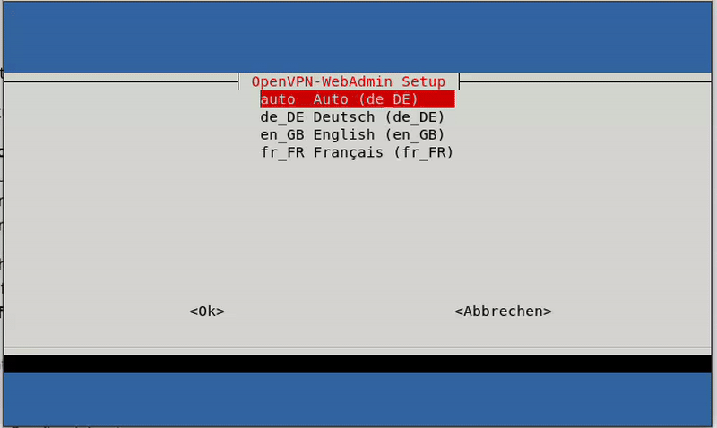
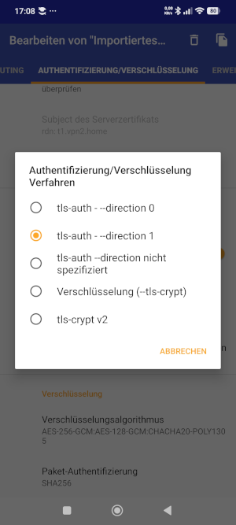

# Overview

## Installation

[🇩🇪 German documentation](README_DE.md)

[🇬🇧 English documentation](README.md)

[🇫🇷 French documentation](README_FR.md)

### System requirements

Developed and tested on **Debian 13**. A bare-bones operating system with `wget` is sufficient. The installation script automatically installs all required libraries, depending on the selected setup configuration.

The setup requires a **configured MariaDB database**, which can be hosted locally or remotely. A database, a corresponding user and the required permissions must be in place for the setup to work correctly.

## Setup

Run the setup as `root`.

If you want to install the latest version, use the following script:

```bash
bash <(wget -qO- 'https://github.com/Wutze/OpenVPN-WebAdmin/raw/refs/heads/main/setup.sh')
```

If you want to install **release 2.0.0**, use the following script:

```bash
bash <(wget -qO- 'https://github.com/Wutze/OpenVPN-WebAdmin/raw/refs/tags/2.0.0/setup.sh')
```

The setup is multilingual.

Follow the questions and instructions. The OpenVPN-WebAdmin frontend will be installed first. Currently, only the Apache configuration has been tested. Nginx support will follow.

You can choose between several options, which should hopefully be self-explanatory.

The update script can select the cached release tag or the latest commits on a branch. It does not query DNS: if no valid cached version is available, it asks for a branch and uses its latest commits; malformed cache JSON is removed. An older valid cache entry is accepted. The installed Git releases and individual database migrations are recorded in `storage/updates/setup-status.json`, whose highest version is also used for update notices. A new installation records its Git start version. For an older installation without a status file, the update asks for and confirms the installed start version once; it must match the actual software and database state to avoid skipping or repeating migrations. An existing status at the former `storage/update/setup-status.json` path is moved to the new path; if both files exist, resolve the conflict before updating. Versioned migration files are run in order; an update with no migrations does not require a database connection. Release documentation in `doc/versions/` is independent of version detection and database migrations.

If a migration fails, inspect the database and status before retrying. MySQL/MariaDB DDL may already have taken effect even if a SQL file fails partway through or its status cannot be saved. Downgrades are not supported.

Once the setup has completed successfully and the Apache web server has been configured, you can log in using the credentials you entered earlier.



### Setting up OpenVPN and RSA keys

Next, run the following script:

```bash
/opt/openvpn-webadmin-src/server/installation/openvpn-setup-easyrsa.sh
```

The setup ensures that Easy-RSA and the OpenVPN server are installed. As no keys have been generated yet, the setup will ask you for some details required to issue the certificates.

The script will then take a few minutes to complete, as generating the `dh.pem` file in particular can take some time.

Once completed successfully, you will have a working OpenVPN configuration. However, connections to the server will not yet be possible. You still need to create users and generate their keys.

### Creating users

After creating new users, you must run the `openvpn-setup-easyrsa.sh` script again to issue their certificates.

```bash
/opt/openvpn-webadmin-src/server/installation/openvpn-setup-easyrsa.sh
```

You can choose either to renew the server certificate or to generate certificates for the users. The required data is retrieved from the database and stored securely.

## Important

**After setting up and installing the OpenVPN server, it is recommended that you reboot the entire system. Only after the reboot can you be sure that connections to the server will work.**

## System update

You can run a system update at any time using the following script:

```bash
/opt/openvpn-webadmin-src/server/installation/update.sh
```

Your local repository at `/opt/openvpn-webadmin-src/` should now be up to date. Your website will then be updated from this repository.

Your configuration files will not be changed. Your own `style.css` and other customisations will also remain untouched.

It's your system – customise it however you like. ;)

No additional files will be deleted. Only modified system files will be replaced with the latest versions without prompting you.

### Note

Some of you may find the help texts particularly useful. However, I have not yet found a way to add custom help texts or extend the existing ones without having those changes overwritten during an update.

This is, however, on my wishlist.

## Android Client – Important!

When configuring the OpenVPN client on Android, connection problems may occur. Please configure the client as shown in the image.

## Android Client – Important!

When configuring the OpenVPN client on Android, connection problems may occur. Please configure the client as shown in the image.


