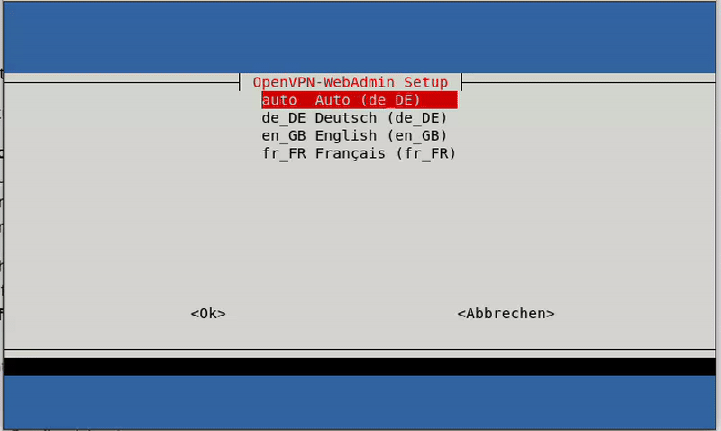
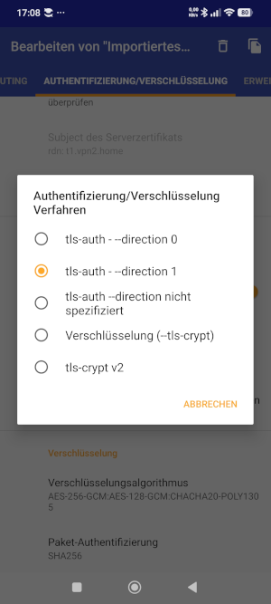

# Übersicht

[🇩🇪 German documentation](README_DE.md)

[🇬🇧 English documentation](README.md)

[🇫🇷 French documentation](README_FR.md)

## Installation

### Systemvoraussetzungen

Getestet und entwickelt unter **Debian 13**. Ein „nacktes“ Betriebssystem mit `wget` genügt. Das Installationsskript installiert automatisch alle notwendigen Bibliotheken, abhängig von der gewählten Setup-Konfiguration.

Das Setup benötigt eine **konfigurierte MariaDB-Datenbank**, die lokal oder remote betrieben werden kann. Damit das Setup ordnungsgemäß funktioniert, müssen eine Datenbank, ein entsprechender Benutzer und die erforderlichen Berechtigungen vorhanden sein.

## Setup

Starte das Setup als `root`:

Du möchtest den gleich den Stand der aktuellsten Version, dann nutze dieses Script:

```bash
bash <(wget -qO- 'https://github.com/Wutze/OpenVPN-WebAdmin/raw/refs/heads/main/setup.sh')
```

Du möchtest das **Release 2.0.0 laden**, dann nutze dieses Script

```bash
bash <(wget -qO- 'https://github.com/Wutze/OpenVPN-WebAdmin/raw/refs/tags/2.0.0/setup.sh')
```

Das Setup ist mehrsprachig aufgebaut.

Folge den Fragen und Anweisungen. Zunächst wird das OpenVPN-WebAdmin-Frontend installiert. Aktuell wurde nur die Konfiguration für Apache getestet. Die Unterstützung für Nginx wird folgen.

Du kannst zwischen verschiedenen Optionen wählen, die hoffentlich selbsterklärend sind.

Beim Setup kannst du die automatische Versionsprüfung aktivieren oder deaktivieren. Ist sie aktiviert, wird der TXT-Record des konfigurierten Hosts (Standard: `ovpn.361-grad.eu`) geprüft. Ein Hinweis erscheint nur, wenn der Record eine neuere gültige Version im Format `X.Y.Z` enthält. Das Ergebnis wird einschließlich DNS-Fehlern 12 Stunden in `storage/cache/` zwischengespeichert; es gibt keine Downloads oder automatischen Updates. Die Option und der DNS-Host können in `config/config.php` über `update_check` und `update_check_dns_host` angepasst werden.

Die installierte Version wird anhand des höchsten Versionsschlüssels in `storage/updates/setup-status.json` bestimmt. Fehlt die Datei oder ist sie ungültig, wird kein Update-Hinweis angezeigt.

Sobald das Setup erfolgreich abgeschlossen und der Apache-Webserver konfiguriert wurde, kannst du dich mit den zuvor eingegebenen Zugangsdaten anmelden.



### Setup von OpenVPN und RSA-Schlüsseln

Führe anschließend folgendes Skript aus:

```bash
/opt/openvpn-webadmin-src/server/installation/openvpn-setup-easyrsa.sh
```

Das Setup stellt sicher, dass Easy-RSA und der OpenVPN-Server installiert sind. Da bisher noch keine Schlüssel generiert wurden, fragt das Setup einige Daten ab, die für die Ausstellung der Zertifikate benötigt werden.

Das Skript benötigt anschließend einige Minuten, da insbesondere die Erstellung der Datei `dh.pem` einige Zeit in Anspruch nimmt.

Nach erfolgreichem Abschluss hast du eine funktionierende OpenVPN-Konfiguration. Verbindungen zum Server sind zu diesem Zeitpunkt allerdings noch nicht möglich. Du musst zunächst Benutzer anlegen und deren Schlüssel erzeugen.

### Benutzer anlegen

Nachdem neue Benutzer angelegt wurden, musst du das Skript `openvpn-setup-easyrsa.sh` erneut ausführen, um die Benutzerzertifikate auszustellen.

```bash
/opt/openvpn-webadmin-src/server/installation/openvpn-setup-easyrsa.sh
```

Du hast die Möglichkeit, entweder das Serverzertifikat zu erneuern oder Zertifikate für die Benutzer erstellen zu lassen. Die benötigten Daten werden aus der Datenbank bezogen und entsprechend sicher abgelegt.

## Wichtig

**Nach dem Setup und der Installation des OpenVPN-Servers empfiehlt es sich, das gesamte System neu zu starten. Erst danach ist sichergestellt, dass Verbindungen zum Server möglich sind.**

## Systemupdate

Das Systemupdate kannst du jederzeit mit folgendem Skript durchführen:

```bash
/opt/openvpn-webadmin-src/server/installation/update.sh
```

Dein lokales Repository unter `/opt/openvpn-webadmin-src/` sollte damit auf dem aktuellen Stand sein. Anschließend wird deine Webseite aus diesem Repository aktualisiert.

Deine Konfigurationen werden dabei nicht verändert. Auch deine eigene `style.css` und weitere Anpassungen bleiben erhalten.

Beim Update kannst du zwischen dem zwischengespeicherten Release und dem neuesten Stand eines Branches wählen. Das Update fragt DNS nicht erneut ab und verwendet auch einen älteren gültigen Cache-Eintrag. Fehlt der Cache oder enthält er keine gültige Version, wird nach Hinweis der neueste Stand des gewählten Branches verwendet; eine beschädigte JSON-Datei wird entfernt. Das Release muss als Git-Tag `X.Y.Z` vorhanden sein; bei „latest“ bestimmt das letzte erreichbare Versions-Tag die Zielversion. Wenn das benötigte Git-Tag oder der Versionsstand nicht ermittelt werden kann, wird abgebrochen.

Der Migrationsstatus liegt in `storage/updates/setup-status.json`. Nur bei einer Neuinstallation wird die Git-Startversion eingetragen. Beim Update wird eine vorhandene Statusdatei unter dem früheren Pfad `storage/update/setup-status.json` übernommen; existieren beide Dateien, muss der Konflikt vor dem Update geklärt werden. Fehlt der Status, muss er vor dem Update wiederhergestellt werden. Versionsordner unter `server/installation/migrations/` enthalten gegebenenfalls nummerierte `*.update.sql`-Dateien, die in Versions- und Nummernreihenfolge ausgeführt und nach Erfolg einzeln im Status vermerkt werden. Ohne SQL-Migrationen ist keine Datenbankverbindung nötig. Die Versionsdokumentation unter `doc/versions/` steuert die Migration nicht.

Bei einem Migrationsfehler stoppt das Update. Vor einem erneuten Versuch müssen Datenbank und Statusdatei geprüft werden: insbesondere können MySQL/MariaDB-DDL-Anweisungen bereits ausgeführt sein, wenn eine SQL-Datei teilweise fehlschlägt oder der Status nicht gespeichert werden kann. Migrationsdateien sollten daher möglichst wiederholbar sein. Ein Downgrade wird nicht unterstützt.

Es ist dein System – verändere es, wie du möchtest. ;)

Es werden keine zusätzlichen Dateien gelöscht. Lediglich geänderte Systemdateien werden ohne Rückfrage durch die aktuelle Version ersetzt.

### Hinweis

Einige von euch werden sicherlich Gefallen an den Hilfetexten finden. Bisher habe ich allerdings noch keine Lösung gefunden, wie sich eigene Ergänzungen und Hilfetexte integrieren lassen, ohne dass diese bei einem Update überschrieben werden.

Das steht jedoch auf meiner Wishlist.

## AndroidClient - Wichtig!

Mit dem Einrichten des OpenVPN-Clients unter Android kann es Verbindungsprobleme geben. Stellt den Client so ein, wie im Bild gezeigt.


