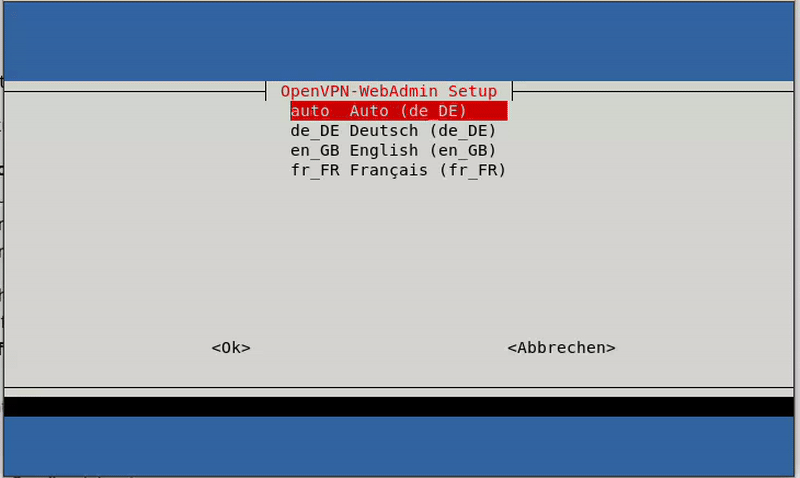

# Aperçu

[🇩🇪 German documentation](README_DE.md)

[🇬🇧 English documentation](README.md)

[🇫🇷 French documentation](README_FR.md)

## Installation

### Configuration requise

Développé et testé sous **Debian 13**. Un système d'exploitation minimal disposant de `wget` suffit. Le script d'installation installe automatiquement toutes les bibliothèques nécessaires, en fonction de la configuration choisie.

L'installation nécessite une **base de données MariaDB configurée**, hébergée localement ou sur un serveur distant. Pour que l'installation fonctionne correctement, une base de données, un utilisateur correspondant et les droits nécessaires doivent être disponibles.

## Installation

Lancez le script d'installation en tant que `root`.

Si vous souhaitez installer la dernière version, utilisez le script suivant :

```bash
bash <(wget -qO- 'https://github.com/Wutze/OpenVPN-WebAdmin/raw/refs/heads/main/setup.sh')
```

Si vous souhaitez installer la **version 2.0.0**, utilisez le script suivant :

```bash
bash <(wget -qO- 'https://github.com/Wutze/OpenVPN-WebAdmin/raw/refs/tags/2.0.0/setup.sh')
```

Le setup est multilingue.

Suis les questions et les instructions. Le frontend OpenVPN-WebAdmin sera d'abord installé. Pour le moment, seule la configuration Apache a été testée. La prise en charge de Nginx sera ajoutée ultérieurement.

Tu peux choisir parmi plusieurs options, qui devraient être suffisamment explicites.

Une fois le setup terminé avec succès et le serveur web Apache configuré, tu peux te connecter avec les identifiants que tu as précédemment renseignés.



### Installation d'OpenVPN et des clés RSA

Exécute ensuite le script suivant :

```bash
/opt/openvpn-webadmin-src/server/installation/openvpn-setup-easyrsa.sh
```

Le setup vérifie que Easy-RSA et le serveur OpenVPN sont installés. Comme aucune clé n'a encore été générée, le setup te demande certaines informations nécessaires à la délivrance des certificats.

Le script prendra ensuite quelques minutes, car la création du fichier `dh.pem`, notamment, nécessite un certain temps.

Une fois l'opération terminée, tu disposeras d'une configuration OpenVPN fonctionnelle. Toutefois, tu ne pourras pas encore te connecter au serveur. Tu dois d'abord créer les utilisateurs et générer leurs clés.

### Création des utilisateurs

Après avoir créé de nouveaux utilisateurs, tu dois relancer le script `openvpn-setup-easyrsa.sh` afin de générer leurs certificats.

```bash
/opt/openvpn-webadmin-src/server/installation/openvpn-setup-easyrsa.sh
```

Tu peux choisir soit de renouveler le certificat du serveur, soit de générer les certificats des utilisateurs. Les données nécessaires sont récupérées depuis la base de données et stockées de manière sécurisée.

## Important

**Après le setup et l'installation du serveur OpenVPN, il est recommandé de redémarrer l'ensemble du système. Ce n'est qu'après ce redémarrage que tu peux être sûr que les connexions au serveur fonctionneront.**

## Mise à jour du système

Tu peux effectuer une mise à jour du système à tout moment à l'aide du script suivant :

```bash
/opt/openvpn-webadmin-src/server/installation/update.sh
```

Ton dépôt local situé dans `/opt/openvpn-webadmin-src/` devrait alors être à jour. Le site web sera ensuite mis à jour à partir de ce dépôt.

Tes fichiers de configuration ne seront pas modifiés. Ton propre `style.css` ainsi que tes autres personnalisations seront également conservés.

C'est ton système : modifie-le comme tu le souhaites. ;)

Aucun fichier supplémentaire ne sera supprimé. Seuls les fichiers système modifiés seront remplacés, sans confirmation, par leur version actuelle.

### Remarque

Certains d'entre vous apprécieront certainement les textes d'aide. Cependant, je n'ai pas encore trouvé de solution permettant d'ajouter ses propres textes d'aide ou de compléter ceux qui existent déjà sans que ces modifications soient écrasées lors d'une mise à jour.

Cela figure néanmoins sur ma wishlist.
